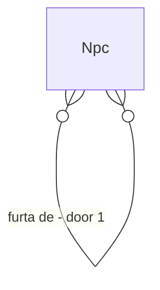

# Crime and theft

## Problem

Não há crime no motor: `grep Theft|Crime|Murder` em `src/` volta vazio. Um NPC faminto sem renda morre ou migra, nunca rouba; ninguém é punido e a segurança da cidade é só contagem de prédios (gap F8). A Fase 23 prevê traição e intriga, mas o nível básico, furto por necessidade ou ganância, não pertence a ela.

Sem crime a pressão de escassez não tem válvula social e a "segurança" que o cliente mostra é decoração. Evidência: `docs/audits/phase-gap-review.md` (F8), `docs/roadmap/phase-23-intrigue.md`.

Quando isto entrar, um NPC faminto ou ganancioso pode furtar um vizinho, ser descoberto e perder relação, e a cidade com guarda tem menos furtos.

## Flow

Reaproveita a utility AI (ação nova do catálogo) e `RelationshipSystem` para consequência.

1. `BehaviorDecisionSystem` (exists, extended) - ação `Steal` entra no catálogo por urgência e traços
2. `TheftResolver` (new, door 1) - resolve pelo primitivo único de resolução (ADR-0011), transfere via `MarketTransaction`
3. `RelationshipSystem` (exists) - `Betrayal` entre ladrão e vítima se descoberto
4. `WorldEventLog` (exists) - evento por furto descoberto, não por tentativa

## Impact

| Front | What changes |
| --- | --- |
| domain | termos: furto, descoberta; quem lê hoje a ação: catálogo de ações e `GET /npcs/{id}` |
| stored data | sem campo novo; mundos antigos seguem sem furto; bytes sobem no máximo 2% |

## Relations

One-way constraints: o furto move moeda, nunca cria (door 1).

## Surface

None - nothing consumed outside

## Landing

| One-way door | Literal shape | Alternative rejected |
| --- | --- | --- |
| 1. ação no catálogo | ação `Steal` com probabilidade pelo primitivo de resolução, alvo da mesma cidade, valor limitado ao saldo da vítima | evento de crime sorteado fora da decisão: a LLM ou o sorteio escreveria no mundo sem passar pela utility AI |

- Nada mais aqui é difícil de reverter

## Criteria

### S1: Furto causal (P1)

**Acceptance Criteria**

1. WHEN a fome é urgente e a renda zero THEN the system SHALL incluir `Steal` entre as ações pontuadas
2. IF o furto tem sucesso THEN the system SHALL mover só moeda existente e manter a conservação
3. The system SHALL produzir o mesmo furto em dois processos, mesma seed

**Independent test:** vila com 10 NPCs sem renda por 1 ano.

### S2: Consequência (P1)

**Acceptance Criteria**

4. WHEN o furto é descoberto THEN the system SHALL aplicar `Betrayal` da vítima sobre o ladrão
5. WHERE a cidade tem guarda THEN the system SHALL ter menos furtos que o controle sem guarda, z ≥ 3 em 20 seeds
6. The system SHALL manter µs por NPC-tick em no máximo 103% e alocação por tick em no máximo 102% do medido, com hash idêntico em dois processos

**Independent test:** par com guarda on/off. Mais o sensor de escala.

## Out of scope

| Excluded | Why |
| --- | --- |
| justiça, prisão e pena | Fase 23 e sistema de governança |
| violência e assassinato | exige morte por agressão, fatia própria |
| crime organizado | Fase 23 (conspiração) |

## Assumptions

| Assumption | Chosen default | Rationale | Confirmed? |
| --- | --- | --- | --- |
| guarda | profissão já existente que o cenário declara | evita profissão nova (AD-046) | n |
| padrão do cenário | furto desligado | preserva o golden do default | n |

**Open questions:** none - all resolved or logged above.

## Observable

None - no user-facing surface

## Sources

- `docs/roadmap/phase-23-intrigue.md`
- ADR-0011 - primitivo único de resolução
- `docs/audits/phase-gap-review.md` (F8)
