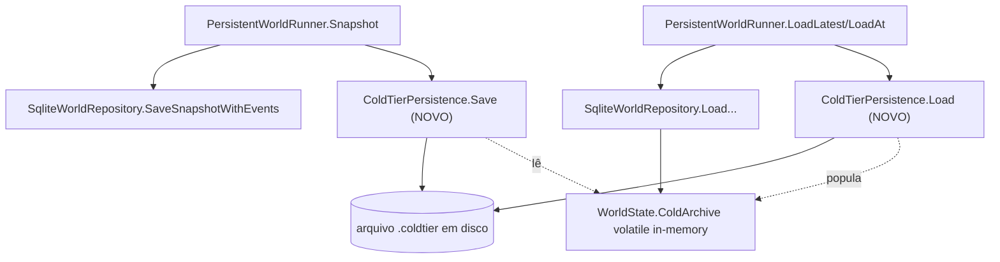

# Dead Code Cleanup — Design

**Spec**: `.specs/features/dead-code-audit/spec.md` (Goals → seção "Execução")
**Relatório-base**: `.specs/features/dead-code-audit/report.md`
**Status**: Implemented (gate completo pendente)

---

## Architecture Overview

Não há arquitetura nova — é remoção/consolidação/correção de fiação dentro dos 6 projetos existentes. O único componente que ganha comportamento novo é o ciclo de save/resume (`PersistentWorldRunner`), que passa a incluir o cold tier no round-trip.

Nenhuma decisão ativa de `.specs/STATE.md` (`## Decisions`, AD-001..033) conflita com este escopo — nenhuma trata de `ScenarioLoader`, `DecisionMetrics`, `ColdTierPersistence` ou dos 4 pares de duplicação. Onde uma consolidação puder alterar um hash canônico (golden/scale-sensor), o padrão AD-014..017/AD-028 (regravar com decisão explícita registrada, nunca silenciosamente) é reaproveitado — não criamos convenção nova.

---

## Code Reuse Analysis

### Existing Components to Leverage

| Component | Location | How to Use |
| --- | --- | --- |
| `ColdTierPersistence.Save/Load` | `src/LivingWorld.Infrastructure/EventLog/ColdTierPersistence.cs` | Já implementa o formato binário completo (magic/version/codec/string-pool) — só falta ser chamado. Reusar como está, sem tocar no formato. |
| `PersistentWorldRunner.Snapshot/LoadLatest/LoadAt` | `src/LivingWorld.Infrastructure/PersistentWorldRunner.cs` | Ponto de integração natural — já é o único lugar que toca `IWorldRepository`, mesma responsabilidade de orquestrar persistência nas fronteiras de snapshot. |
| Padrão AD-014..017/AD-028 (regravar baseline com decisão registrada) | `.specs/STATE.md` | Reusar o mesmo processo para qualquer hash canônico que mudar por efeito das consolidações do P7. |
| `ScenarioLoaderV2.LoadWorld` | `src/LivingWorld.Simulation/Scenarios/ScenarioLoaderV2.cs` | Destino da migração do teste `PopulationArchitectureTests.cs` antes de remover `ScenarioLoader` v1. |

### Integration Points

| System | Integration Method |
| --- | --- |
| `PersistentWorldRunner` ↔ `ColdTierPersistence` | Composição direta — `PersistentWorldRunner` ganha um campo opcional `ColdTierPersistence?`; `null` = comportamento de hoje (sem cold tier em disco), usado quando não há caminho de arquivo real (ex.: `Data Source=:memory:` no Api). |
| `ColdTierArchive` ↔ `ColdTierPersistence` | `ColdTierArchive` ganha dois membros novos (`AllNpcSummaries`, `RestoreNpcSummaries`) — únicos pontos de acesso em massa; nenhum consumidor existente muda. |
| Workers CLI (`persist-save`/`persist-resume`) | Deriva o caminho do cold tier do mesmo `dbPath` já recebido (`{dbPath}.coldtier`), sem novo parâmetro de linha de comando. |
| Api (`Program.cs`) | Deriva o caminho do cold tier da connection string `World` quando ela aponta pra um arquivo real; `:memory:` (dev default) não ativa persistência de cold tier — mesma regra do Workers. |

---

## Components

### `ColdTierArchive` (modificado)

- **Purpose**: Expor os `NpcSummary` arquivados em massa (save) e aceitar reidratação em massa (load), sem mudar nenhum comportamento de arquivamento/lookup existente.
- **Location**: `src/LivingWorld.Simulation/Population/Archive/ColdTierArchive.cs`
- **Interfaces (novos)**:
  - `IReadOnlyDictionary<long, NpcSummary> AllNpcSummaries { get; }` — snapshot somente-leitura do dicionário interno, para `ColdTierPersistence.Save`
  - `void RestoreNpcSummaries(IReadOnlyDictionary<long, NpcSummary> entries)` — substitui `_byId` inteiro (usado só na reidratação, nunca durante o tick)
- **Dependencies**: nenhuma nova
- **Reuses**: estrutura `_byId` já existente

### `PersistentWorldRunner` (modificado)

- **Purpose**: Continuar orquestrando tick+persistência, agora incluindo o cold tier na mesma fronteira de snapshot.
- **Location**: `src/LivingWorld.Infrastructure/PersistentWorldRunner.cs`
- **Interfaces (assinatura nova)**:
  - `PersistentWorldRunner(IWorldRepository repository, BranchId branch, long snapshotIntervalTicks, ColdTierPersistence? coldTier = null)`
  - `Snapshot` passa a chamar `coldTier?.Save(world.ColdArchive.AllNpcSummaries, world.Calendar)` dentro do mesmo `lock (_repositoryGate)`, depois de `repository.SaveSnapshotWithEvents`
  - `LoadLatest`/`LoadAt` passam a chamar `world.ColdArchive.RestoreNpcSummaries(coldTier.Load(world.Calendar))` quando `coldTier is not null` e a deserialização teve sucesso
- **Dependencies**: `ColdTierPersistence` (opcional, injetado pelo chamador)
- **Reuses**: `_repositoryGate` existente cobre a nova chamada — save de snapshot + save de cold tier viram uma única seção crítica lógica (não uma transação de banco, mas equivalente ao que já valia pra `SaveSnapshotWithEvents` sozinho)

### Wiring em `LivingWorld.Workers/Program.cs` e `LivingWorld.Api/Program.cs`

- **Purpose**: Construir `ColdTierPersistence` a partir do `dbPath`/connection string já existente, sem novo parâmetro de configuração.
- **Location**: `src/LivingWorld.Workers/Program.cs` (`persist-save`/`persist-resume`), `src/LivingWorld.Api/Program.cs`
- **Regra**: `dbPath` real (não `:memory:`) → `new ColdTierPersistence(dbPath + ".coldtier")`; caso contrário → `null` (sem persistência de cold tier, comportamento de hoje).

### Helpers de consolidação (P7)

| Helper novo | Substitui | Location |
| --- | --- | --- |
| `IVersionedRepository<TKey,TRecord>` (ou método de extensão LINQ `LatestOrDefault`/`AtVersionOrDefault`) | Query duplicada em `SqliteWorldRepository`/`SqlitePeriodTemplateRepository` | `src/LivingWorld.Infrastructure/Repositories/` |
| Switch-com-fallback compartilhado | Duplicação `GlobalLayerBuilder`/`CityLayerBuilder` | `src/LivingWorld.Api/Visual/Layers/` |
| Helper de threshold+scheduling de fundação | Duplicação `SettlementFoundingSystem`/`SpatialSettlementFoundingSystem` | `src/LivingWorld.Simulation/Cities/Founding/` |
| `static T Resolve<T>(T? declared, T @default) where T : class` | 4 métodos `Resolve` idênticos em `AttentionRules`/`PowerUtilityRules`/`PowerInheritanceRules`/`BodyRules` | `src/LivingWorld.Domain/Shared/` (novo local canônico, tipo estático simples) |

A forma exata de cada helper (classe genérica vs. método de extensão vs. interface) fica a critério de quem implementar a task — o relatório já documenta a duplicação, o objetivo é eliminar a repetição sem prescrever a abstração final, na mesma linha do critério P4 original.

---

## Data Models

Nenhum modelo de dado novo. `ColdTierPersistence`'s formato binário (`Magic`/`FormatVersion`/codec/string-pool/`NpcSummary` serializado) já existe e não muda — só passa a ser chamado.

---

## Error Handling Strategy

| Error Scenario | Handling | User Impact |
| --- | --- | --- |
| `ColdTierPersistence.Load` lança (`InvalidDataException` — magic/versão/calendário incompatível) num resume real | Propaga a exceção (mesmo comportamento de hoje pra `WorldSnapshot.Deserialize` falhar) — não silencia corrupção de dado histórico | Resume falha explicitamente; operador corrige/descarta o arquivo `.coldtier` manualmente, mesma classe de operação que já existe pra um `.db` corrompido |
| Cold tier ainda não existe (primeiro save de um mundo novo, ou resume de um snapshot salvo antes desta mudança) | `ColdTierPersistence.Load` já trata isso — retorna dicionário vazio quando `File.Exists` é falso; nenhuma mudança necessária | Nenhum — comportamento de compatibilidade retroativa já embutido na classe |
| `coldTier` é `null` (dev in-memory) | `Snapshot`/`LoadLatest`/`LoadAt` pulam a chamada (`coldTier?.Save`, `if (coldTier is not null)`) | Nenhum — mesmo comportamento de hoje, dado frio só existe em memória durante o processo |
| Consolidação (P7) muda um hash canônico inesperadamente | Task correspondente NÃO regrava a baseline sozinha — para, investiga se é efeito puramente estrutural (mesmo valor lógico) antes de decidir regravar com AD registrado | Nenhuma regressão silenciosa entra despercebida |

---

## Risks & Concerns

| Concern | Location (file:line) | Impact | Mitigation |
| --- | --- | --- | --- |
| `ColdTierPersistence` só serializa `NpcSummary` — `AnimalSummary`/`PlantSummary` de `ColdTierArchive` não têm formato de disco nenhum | `src/LivingWorld.Infrastructure/EventLog/ColdTierPersistence.cs:37,53` vs `src/LivingWorld.Simulation/Population/Archive/ColdTierArchive.cs:44-62` | Plugar o cold tier em produção fecha o gap pra NPCs mortos, mas fauna/flora arquivados continuam se perdendo num restart real — mesma classe de gap que motivou esta rodada, só que fora do escopo confirmado (spec cita só a promessa da Fase 28 sobre compressão de NPC/estado histórico) | Registrar explicitamente como gap residual conhecido (não corrigido nesta rodada) em vez de deixar implícito; se o usuário quiser fechar também fauna/flora, é extensão de formato — task separada, fora do escopo P6 atual |
| `PersistentWorldRunner.Snapshot`/`LoadLatest`/`LoadAt` não são transacionais entre o `.db` SQLite e o arquivo `.coldtier` — são duas escritas/leituras de armazenamento diferentes | `src/LivingWorld.Infrastructure/PersistentWorldRunner.cs:19-61` | Uma falha entre salvar o snapshot e salvar o cold tier (ex.: processo morto no meio) deixa os dois arquivos levemente dessincronizados — o cold tier ficaria com um ano de defasagem do snapshot | Aceitável: o cold tier é dado de NPCs já mortos e imutáveis (não muda mais depois de arquivado) — reler um cold tier "um pouco velho" na pior falha ainda é correto, só não tem os arquivamentos mais recentes; não introduz corrupção, só atraso. Não vale a complexidade de uma transação real de dois armazenamentos pra esse caso |
| Api usa `Data Source=:memory:` como default (`Program.cs:36`) — não há arquivo de banco real no caminho comum de desenvolvimento | `src/LivingWorld.Api/Program.cs:36` | Cold tier plugado só é exercitado de verdade quando alguém configura uma connection string com arquivo real — o caminho de dev in-memory continua sem cobertura de round-trip real do cold tier | Independent Test do P6 usa o CLI de Workers (`persist-save`/`persist-resume`), que sempre tem `dbPath` real — cobre o caminho que a spec pede provar. Api com arquivo real fica coberto pela mesma lógica de derivação de caminho, sem teste dedicado adicional (mesmo padrão de confiança que o resto do save/load já tem hoje) |
| Consolidar `SettlementFoundingSystem`/`SpatialSettlementFoundingSystem` (P7) mexe em código que decide fundação de cidade — sensível a hash canônico | `src/LivingWorld.Simulation/Cities/Founding/*.cs` | Uma extração descuidada do threshold/scheduling pode mudar a ORDEM de avaliação entre os dois sistemas e alterar o tick exato de fundação em algum cenário | Task dedicada roda golden hash antes/depois isoladamente (EXEC-12 no spec); geometria de materialização (grid vs cluster) permanece intocada, só o helper de threshold é compartilhado |

> Nenhum risco de segurança, N+1 ou cobertura de teste faltando além dos listados acima.

---

## Tech Decisions

| Decision | Choice | Rationale |
| --- | --- | --- |
| `ColdTierPersistence` no `PersistentWorldRunner` | Campo opcional (`ColdTierPersistence? = null`), não obrigatório | Evita quebrar o caminho de dev in-memory (`:memory:`) e qualquer teste existente que já constrói `PersistentWorldRunner` com a assinatura de 3 argumentos — construtor com default é aditivo, não breaking |
| Caminho do arquivo de cold tier | Derivado por convenção (`{dbPath}.coldtier`), sem config nova | Mesma filosofia de `WorldDbContextFactory`/connection string — um arquivo por banco, sem superfície de configuração adicional pra manter |
| Fauna/flora do cold tier | Fora do escopo desta rodada (ver Risks) | Spec e decisão do usuário miraram a promessa da Fase 28 sobre NPCs/histórico; estender o formato binário pra 3 tipos é trabalho maior, melhor como task própria se decidido depois |
| Forma final dos 4 helpers de consolidação (P7) | Não prescrita aqui — cada task de implementação escolhe (classe estática, extensão LINQ, ou interface) | Mesmo princípo do P4 original do relatório: sinaliza a oportunidade, não decide a abstração final; evita over-design antes de ver o diff real |

> Nenhuma decisão acima estabelece uma convenção de projeto nova o suficiente para virar `AD-NNN` — todas são locais a este cleanup. Se a consolidação do P7 (ex.: `IVersionedRepository`) acabar sendo reusada por uma feature futura, ela vira candidata a `AD-NNN` retroativo naquele momento, não agora.

---

## Tips (referência do processo, não do produto)

Design cobre 4 frentes (remoção, cold tier, consolidação, comentários) — a fase Tasks a seguir quebra cada uma em tasks atômicas por projeto, já que o volume (~888 comentários / 193 arquivos) não cabe em uma tarefa só.
