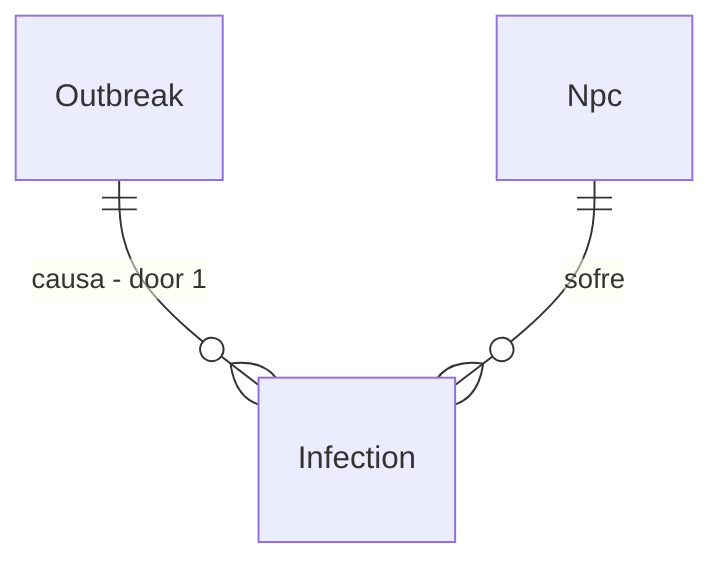

# Disease epidemics

## Problem

O mundo não tem doença: o único `Disease|Infection|Plague` em `src/` é de fauna e de mecânica extraordinária. A saúde do NPC cai por fome, sede e idade; não há contágio, e nenhuma causa de morte depende de densidade de população, higiene ou água, o que torna as cidades grandes tão seguras quanto as pequenas e elimina o limite natural de crescimento.

A Fase 22 (imperfeição) prevê doenças, mas só como defeito individual. Esta fatia entrega o mínimo: contágio determinístico por proximidade, com mortalidade e imunidade. Evidência: `docs/roadmap/phase-22-imperfection.md`.

Quando isto entrar, uma doença nasce de condição ambiental, se espalha por contato no mesmo prédio ou cidade e some por imunidade, deixando efeito visível na demografia.

## Flow

Reaproveita ocupação de prédios (`npc-building-occupancy`) para saber quem se encontra, e o RNG semeado do mundo.

1. `OutbreakSystem` (new, door 1) - Daily, abre surto por condição (água ruim, densidade)
2. `NpcBuildingOccupancy` (exists) - quem divide prédio no mesmo dia
3. `HealthSystem` (exists, extended) - dano de saúde e recuperação por doença
4. `NpcDeath` (exists) - causa `Disease`
5. `WorldEventLog` (exists) - surto como evento por cidade, não por NPC

## Impact

| Front | What changes |
| --- | --- |
| domain | termos: surto, imunidade; quem lê hoje a saúde: `HealthSystem` |
| stored data | campo de estado da doença e imunidade no NPC (nulo na maioria); mundos antigos ficam sem doença; bytes sobem no máximo 3% |

## Relations

One-way constraints: uma infecção ativa por NPC e doença; imunidade expira por calendário (door 1).

## Surface

None - nothing consumed outside

## Landing

| One-way door | Literal shape | Alternative rejected |
| --- | --- | --- |
| 1. estado da doença | doença como vetor de eixos (contágio, letalidade, duração) do cenário, estado por NPC como (doençaId, diaFim) | enum de doenças nomeadas: contradiz ADR-0013 e a Fase 24 |

- Nada mais aqui é difícil de reverter

## Criteria

### S1: Contágio determinístico (P1)

**Acceptance Criteria**

1. WHEN um infectado divide prédio com suscetível THEN the system SHALL calcular contágio por RNG semeado do par (npc, dia)
2. The system SHALL gerar o mesmo surto em dois processos, mesma seed
3. IF o NPC está imune THEN the system SHALL não infectar

**Independent test:** vila de 1 ano com doença semeada no dia 10.

### S2: Efeito demográfico (P1)

**Acceptance Criteria**

4. WHEN um surto termina THEN the system SHALL ter mortalidade entre 0,5x e 1,5x da letalidade declarada
5. The system SHALL manter nascimentos e economia da vila padrão sem colapso (população final ≥ 70% do controle sem doença)
6. The system SHALL manter µs por NPC-tick em no máximo 103% e alocação por tick em no máximo 102% do medido, com hash idêntico em dois processos

**Independent test:** par com doença on/off em 8 seeds, 5 anos. Mais o sensor de escala.

## Out of scope

| Excluded | Why |
| --- | --- |
| doença emergente nomeada | Fase 24 |
| medicina e cura como profissão | profissão nova muda calibração (AD-046) |
| defeitos congênitos | Fase 22 |

## Assumptions

| Assumption | Chosen default | Rationale | Confirmed? |
| --- | --- | --- | --- |
| fonte do surto | água ruim e densidade acima do limiar do cenário | só dados já no estado | n |
| padrão do cenário | doenças desligadas | não muda o golden do default | n |

**Open questions:** none - all resolved or logged above.

## Observable

None - no user-facing surface

## Sources

- `docs/roadmap/phase-22-imperfection.md`
- `.specs/features/npc-building-occupancy/plan.md`
- ADR-0013
