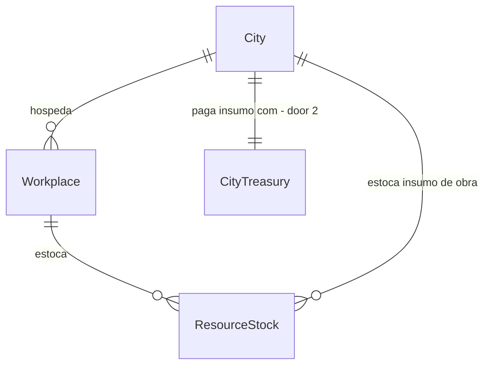

# Economy depth

## Problem

O ferro é produzido e precificado, mas nenhuma receita o usa e `demandBaselinePerNpc` só cobre trigo e água:
`ScenarioRunner.DefaultEconomyRules` tem 3 recursos e 2 profissões, contra 5 recursos e 8 profissões no roadmap
da Fase 5. Toda receita padrão tem `Inputs = {}`: é coleta, não cadeia. O catálogo de cidade padrão não tem
receita de construção, e `City.Stock` só é alimentado na fundação de assentamento (`WorldState.Cities`), então
crescer a cidade nunca gasta material. Quem paga é o objetivo "mundo vivo": preço, escassez e migração por
falta de moradia não têm o que reagir. Evidência: `docs/audits/phase-gap-review.md` (F5, F8) e AD-089.

Quando isto entrar, faltar madeira ou pedra atrasa obras e aperta a moradia, e o ferro passa a ser consumido.

## Flow

Reaproveita `ProductionSystem`, `MarketPricingSystem`, `ConstructionDemandSystem` e `ConstructionSystem` em vez
de criar economia paralela.

1. `ScenarioRunner.DefaultEconomyRules` e `DefaultEconomyCatalog` (exists) - declaram recursos 3 e 5, receitas e salários
2. `SeedDefaultWorkplaces` (exists) - cria serraria e pedreira por cidade; `EmploymentSystem` (exists) contrata lenhador e pedreiro
3. `ProductionSystem` (exists) - consome `Inputs` e deposita saída no estoque da oficina; `MarketPricingSystem` (exists) precifica
4. `ConstructionSupplySystem` (new, door 2) - leva insumo faltante do estoque de oficinas da cidade ao `City.Stock`, pago pela cidade
5. `ConstructionDemandSystem` e `ConstructionSystem` (exists) - abrem a obra e retiram `Inputs` de `City.Stock`

## Impact

| Front | What changes |
| --- | --- |
| domain | novos termos de cenário: madeira (recurso 3), pedra (recurso 5), serraria (local 3), pedreira (local 4), lenhador (profissão 3), pedreiro (profissão 4) |
| domain | `City.Stock` passa a ser alimentado por compra, não só por fundação; quem lê hoje: `ConstructionSystem`, `LivingScopeState`, inspeção da cidade |
| stored data | mundos salvos antes não têm oficinas novas nem tesouro de cidade: nada a migrar, leitor assume vazio; goldens e pins de hash regravados uma vez |

## Relations

One-way constraints: o tesouro da cidade nunca fica negativo (door 2).

## Surface

None - nothing consumed outside

## Landing

| One-way door | Literal shape | Alternative rejected |
| --- | --- | --- |
| 1. ids de cenário | recurso 3 = madeira, 5 = pedra; local 3 = serraria, 4 = pedreira; profissão 3 = lenhador, 4 = pedreiro (o motor só vê o id) | ids derivados de nome: o motor é id-only e o nome é volátil (ADR-0014) |
| 2. tesouro da cidade persistido | `City.Treasury` (dinheiro) no estado canônico, lido tolerante a ausência | pagar do tesouro da oficina vendedora: dinheiro só trocaria de bolso dentro da mesma oficina e a conservação não provaria nada |

- Nada mais aqui é difícil de reverter

## Criteria

### S1: A cadeia tem insumo (P1)

O ferreiro deixa de ser coleta pura: consome ferro e madeira.

**Acceptance Criteria**

1. WHEN uma oficina com receita de insumo fecha um ciclo de produção THEN the system SHALL retirar exatamente os `Inputs` declarados e depositar exatamente os `Outputs` declarados
2. IF a oficina não tem algum insumo THEN the system SHALL produzir 0 nesse ciclo e deixar estoque e tesouro idênticos
3. The system SHALL declarar para todo recurso do catálogo ao menos um produtor e ao menos um consumidor

**Independent test:** rodar 30 dias com ferreiro e serraria, conferir o saldo de ferro e madeira contra a receita.

### S2: Lenhador e pedreiro trabalham (P1)

**Acceptance Criteria**

4. WHEN a serraria ou a pedreira tem vaga THEN the system SHALL contratar NPC elegível e emitir `Hired`
5. WHILE o NPC é lenhador ou pedreiro empregado the system SHALL pagar o salário declarado todo mês e aplicar a janela de `Work` declarada na rotina
6. IF o tesouro da oficina não cobre o salário THEN the system SHALL pagar a fração proporcional a todos e emitir `WageUnpaid` (regra existente de AD-082)

**Independent test:** vila padrão por 1 ano: há contratados nas duas profissões novas e a folha foi paga.

### S3: A cidade compra material para obra (P1)

**Acceptance Criteria**

7. WHEN a obra aprovada precisa de insumo que falta em `City.Stock` e uma oficina da mesma cidade o tem THEN the system SHALL transferir o menor entre a falta e o estoque da oficina, ao preço da oficina, debitando o tesouro da cidade
8. IF o tesouro da cidade não cobre o preço THEN the system SHALL transferir 0 e manter o hash idêntico
9. WHEN `City.Stock` tem todos os `Inputs` THEN the system SHALL retirar exatamente a receita (comportamento existente, provado de novo com o catálogo padrão)

**Independent test:** cidade com déficit de moradia constrói uma casa e o estoque das oficinas cai pelo valor comprado.

### S4: Escassez reage (P2)

**Acceptance Criteria**

10. WHEN a produção de madeira é zerada (braço tratamento) THEN the system SHALL elevar o preço da madeira e concluir menos obras em 360 dias que o controle em pelo menos 18 de 20 seeds

**Independent test:** par controle/tratamento com o harness econômico existente.

### S5: Conservação e custo (P1)

**Acceptance Criteria**

11. The system SHALL conservar dinheiro total e o total de cada recurso (oficinas, casas, cidade) em toda amostra diária, 10 anos, salvo produção, consumo e perda declarados
12. The system SHALL manter, nas 5 seeds do `MeasureHarness`, ao menos 90% da soma de população do ano 10 medida antes desta feature
13. The system SHALL manter µs por NPC-tick do fixture de 1.000 NPCs em no máximo 105% e alocação por tick em no máximo 102% do medido antes

**Independent test:** `MeasureHarness` antes e depois, mesma máquina, rodadas alternadas.

## Out of scope

| Excluded | Why |
| --- | --- |
| curandeiro e professor | sem sistema de saúde ou escola que os consuma; viraria stub (`rules/living-world-cohesion.md`) |
| comércio entre cidades | depende de rotas e preço regional (Fase 10+) |
| imposto como fonte do tesouro da cidade | spec própria; aqui o tesouro nasce de uma dotação inicial declarada |
| tecnologia emergente de ferramenta | Fase 24 |

## Assumptions

| Assumption | Chosen default | Rationale | Confirmed? |
| --- | --- | --- | --- |
| de onde vem o dinheiro do tesouro da cidade | dotação inicial declarada no cenário, sem imposto | imposto exige `Mint/Destroy` de produção, hoje sem fonte | n |
| peso inicial no sorteio de profissão | lenhador e pedreiro com metade do peso de lavrador | mantém a vila alimentada (AD-046) | n |
| reserva inicial de madeira e pedra por oficina | igual à de trigo por casa (50) | construção só começa depois do primeiro ciclo sem isso | n |

**Open questions:** 1 - bloqueia os critérios 7 e 8.

| # | Kind | Question | Until answered |
| --- | --- | --- | --- |
| 1 | blocks | a cidade paga o insumo com tesouro próprio (recomendado, reaproveita preço) ou recebe sem pagar | critério 7 e 8 |

## Observable

| Surface | Decision | Landing |
| --- | --- | --- |
| scenario JSON v2 (ids novos) | validação de recurso sem produtor ou consumidor | AC 3 |
| inspeção da cidade (`GET /npcs`, cidade) | estoque e tesouro visíveis | n/a - campos novos entram no contrato congelado `tests/contracts/` por regravação explícita, fora desta feature |
| comando de worker | n/a | n/a - nenhum comando novo |

## Sources

- `docs/roadmap/phase-05-economy.md` - 5 recursos, 8 profissões, conservação
- `docs/audits/phase-gap-review.md` e AD-089 - o que ficou sem consumidor
