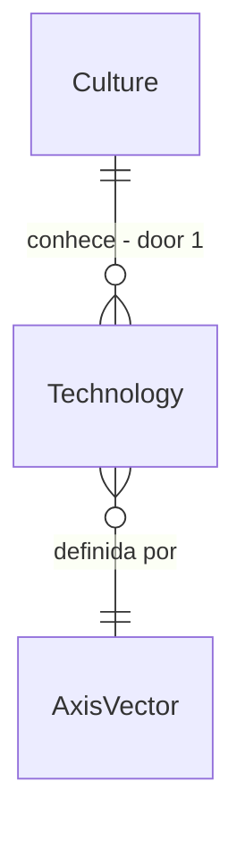

# Emergence first slice

## Problem

A Fase 24 (emergência aberta) é só `spec`: raça, tecnologia e ideologia novas não existem, o motor só tem catálogos declarados. Nada em `LivingWorld.Simulation` deriva entidade nova por composição de eixos nem tem limiar de novidade, e `.specs/features/emergent-vehicles/` depende disso.

A primeira fatia entrega só o mecanismo mínimo: tecnologia como composição de eixos com limiar de novidade determinístico, sem nome (ADR-0013). Evidência: `docs/roadmap/phase-24-emergence.md`.

Quando isto entrar, duas vilas isoladas que resolvem o mesmo problema geram tecnologias distintas, e o motor decide entre variação e entidade nova por um limiar do cenário.

## Flow

Camada pequena nova sobre eixos declarados no cenário; nenhum sistema existente muda de regra.

1. `ScenarioLoaderV2` (exists, extended) - declara eixos e limiar de novidade
2. `TechDiscoverySystem` (new, door 1) - pressão, observação, habilidade e recursos viram hipótese, protótipo e adoção
3. `NoveltyThreshold` (new, door 1) - distância entre vetores decide variação ou entidade nova
4. `RelationshipSystem` (exists) - adoção espalha por familiaridade
5. `WorldEventLog` (exists) - registra a descoberta, ainda sem nome

## Impact

| Front | What changes |
| --- | --- |
| domain | termos: eixo, vetor de tecnologia, limiar de novidade; nome é rótulo posterior (ADR-0013) |
| stored data | lista de tecnologias por cultura no estado canônico; mundos antigos começam sem nenhuma; bytes sobem pouco |

## Relations

One-way constraints: tecnologia é identificada só pelo vetor, nunca por nome (door 1).

## Surface

| Route | In | Out | Status |
| --- | --- | --- | --- |
| `GET /cultures/{id}/technologies` | `fromTick` | vetores e adoção | 200, 404 |

## Landing

| One-way door | Literal shape | Alternative rejected |
| --- | --- | --- |
| 1. identidade da tecnologia | vetor de eixos inteiros com limiar de distância declarado no cenário; sem enum de nomes | catálogo de tecnologias nomeadas: contradiz ADR-0013 e não emerge |

- Nada mais aqui é difícil de reverter

## Criteria

### S1: Descoberta determinística (P1)

**Acceptance Criteria**

1. WHEN pressão, observação, habilidade e recursos coincidem THEN the system SHALL abrir hipótese e gastar recursos e tempo no protótipo
2. The system SHALL gerar o mesmo vetor para a mesma seed em dois processos
3. IF o vetor fica abaixo do limiar de um existente THEN the system SHALL registrar variação, não entidade nova

**Independent test:** vila com pressão de trajeto longo por 20 anos, 10 seeds.

### S2: Isolamento gera variantes (P1)

**Acceptance Criteria**

4. WHEN duas culturas isoladas resolvem o mesmo problema THEN the system SHALL produzir vetores diferentes em pelo menos 50% das seeds
5. The system SHALL manter a conservação dos recursos gastos no protótipo
6. WHEN `GET /cultures/{id}/technologies` recebe cultura válida THEN the system SHALL responder 200 com os vetores
7. IF a cultura não existe THEN the system SHALL responder 404
8. The system SHALL manter µs por NPC-tick em no máximo 103% e alocação por tick em no máximo 102% do medido, com hash idêntico em dois processos

**Independent test:** dois cenários isolados por 30 anos. chamada HTTP contra mundo de teste. Mais o sensor de escala.

## Out of scope

| Excluded | Why |
| --- | --- |
| raças, ideologias e potências emergentes | fatias seguintes da Fase 24 |
| nomeação por LLM | só rótulo, fora desta fatia (Fase 11) |

## Assumptions

| Assumption | Chosen default | Rationale | Confirmed? |
| --- | --- | --- | --- |
| primeira categoria | mobilidade | é a que `emergent-vehicles` precisa | n |

**Open questions:** none - all resolved or logged above.

## Observable

| Surface | Decision | Landing |
| --- | --- | --- |
| API `/cultures/{id}/technologies` | error shape and codes | AC 7 |

## Sources

- `docs/roadmap/phase-24-emergence.md`
- ADR-0013 - emergência aberta
