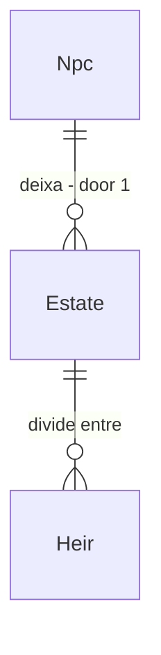

# Estate inheritance

## Problem

Quando um NPC morre, `NpcDeath` e `HouseholdRedistribution` cuidam de órfãos e do domicílio, mas não há herança de bens: os únicos `Inherit` em `src/` são de poder extraordinário (`PowerInheritanceResolver`). A carteira e o estoque do morto saem do mundo ou ficam no domicílio sem regra, e propriedade de oficina não passa para ninguém.

Isso quebra a conservação de moeda que o resto da economia respeita e remove a pressão realista de famílias ricas e pobres ao longo de gerações (Fase 7). Evidência: `grep` de herança em `src/LivingWorld.Simulation` sem sistema de bens.

Quando isto entrar, a morte transfere carteira e estoque pelo parentesco, em ordem fixa, sem criar nem destruir moeda.

## Flow

Reaproveita `MarketTransaction` (atômica) e o parentesco da Fase 7; nenhum mecanismo de transferência novo.

1. `NpcDeath` (exists, extended) - na morte chama a herança
2. `EstateSystem` (new, door 1) - monta a ordem: cônjuge, filhos, pais, irmãos, tesouro da cidade
3. `MarketTransaction` (exists) - move carteira e estoque de forma atômica
4. `WorldEventLog` (exists) - grava `EstateSettled` com herdeiros e valores

## Impact

| Front | What changes |
| --- | --- |
| domain | novo termo: espólio; quem lê hoje a carteira do morto: `NpcDeath`, auditoria de conservação |
| stored data | mundos salvos já têm mortos sem herança: nada a migrar; bytes por NPC por ano sobem no máximo 2% |

## Relations

One-way constraints: o espólio é liquidado uma vez por morte e soma das partes é igual ao total (door 1).

## Surface

None - nothing consumed outside

## Landing

| One-way door | Literal shape | Alternative rejected |
| --- | --- | --- |
| 1. ordem de herança | cônjuge vivo, depois filhos em partes iguais por id crescente, depois pais, depois irmãos, resto ao tesouro da cidade | testamento escolhido pelo NPC: exige decisão de LLM ou utilidade nova, fora do escopo |

- Nada mais aqui é difícil de reverter

## Criteria

### S1: Espólio conservado (P1)

**Acceptance Criteria**

1. WHEN um NPC morre THEN the system SHALL transferir 100% da carteira e do estoque aos herdeiros pela ordem fixa
2. IF não há herdeiro vivo THEN the system SHALL passar tudo ao tesouro da cidade
3. The system SHALL manter a soma de moeda do mundo igual antes e depois da morte

**Independent test:** 30 dias da vila padrão com mortes e auditoria de conservação.

### S2: Reação social (P2)

**Acceptance Criteria**

4. WHEN há herdeiro NPC THEN the system SHALL aplicar `ApplyEvent` de herança entre morto e herdeiro
5. WHERE o morto era dono de oficina THEN the system SHALL passar a oficina ao herdeiro de menor id presente
6. The system SHALL manter µs por NPC-tick em no máximo 103% e alocação por tick em no máximo 102% do medido, com hash idêntico em dois processos

**Independent test:** vila de 1 ano com ao menos uma morte de dono. Mais o sensor de escala.

## Out of scope

| Excluded | Why |
| --- | --- |
| testamento e deserdação | decisão de NPC, Fase 22/23 |
| imposto sobre herança | depende de `taxes-treasury` |
| herança de poder extraordinário | já existe (Fase 16) |

## Assumptions

| Assumption | Chosen default | Rationale | Confirmed? |
| --- | --- | --- | --- |
| menores de idade | herdam, administrados pelo domicílio atual | evita estado novo de tutela | n |
| partes | divisão inteira, resto ao de menor id | determinístico | n |

**Open questions:** none - all resolved or logged above.

## Observable

None - no user-facing surface

## Sources

- `docs/roadmap/phase-07-family.md`
- `src/LivingWorld.Simulation/Population/Lifecycle/NpcDeath.cs`
- AD-044 - vendedor é oficina
