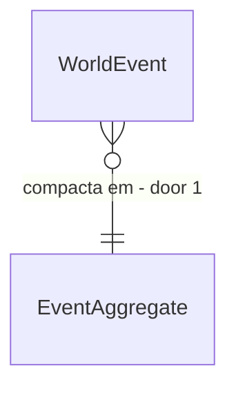

# Event log size budget

## Problem

A Fase 9 declara a meta de event log em no máximo 50 B por NPC vivo por ano após compactação (hoje o roadmap estima 350 a 900 B), mas só o snapshot tem sensor (`scale-sensor.json`: 43.863 e 56.846 B/NPC/ano). O log de eventos não tem sensor próprio, e a compressão de estado frio da Fase 28 (T1) não foi medida contra a meta; o `canon-bytes-per-report.json` cobre só relatos.

Sem medir não há como saber se `trade-ledger`, `estate-inheritance` e demais fatias estouram o teto. Evidência: `docs/roadmap/phase-09-scale.md`, `tests/baselines/`.

Quando isto entrar, existe um sensor de bytes de event log por NPC vivo por ano com teto versionado, e a compactação de fatos frios o respeita.

## Flow

Reaproveita o `ScaleScenarioSensorTests` e a compactação da Fase 28; só soma a medida do log.

1. `ScaleScenarioSensorTests` (exists, extended) - mede bytes do log por tipo de evento em 1.000 e 5.000 NPCs
2. `WorldEventLog` (exists) - tier quente e frio (ADR-0006)
3. `ColdStateCompactor` (exists, extended, door 1) - compacta evento frio em agregado quando passa do teto
4. `tests/baselines/event-log-bytes.json` (new) - baseline versionado por tipo

## Impact

| Front | What changes |
| --- | --- |
| domain | termo: compactação de evento frio |
| stored data | eventos frios de mundos antigos ficam como estão; os novos viram agregado; nada a migrar |

## Relations

One-way constraints: o fato imutável da Fase 10 nunca é compactado, só evento de ruído (door 1).

## Surface

None - nothing consumed outside

## Landing

| One-way door | Literal shape | Alternative rejected |
| --- | --- | --- |
| 1. o que compacta | evento de ruído (movimento, troca, ação rotineira) vira agregado diário por cidade; fato de história e morte ficam imutáveis | compactar tudo: apaga o esqueleto de fato da Fase 10 |

- Nada mais aqui é difícil de reverter

## Criteria

### S1: Sensor do log (P1)

**Acceptance Criteria**

1. The system SHALL medir bytes de event log por NPC vivo por ano por tipo de evento no fixture de 1.000 NPCs
2. WHEN o sensor roda THEN the system SHALL falhar se o total passar de 110% do baseline versionado

**Independent test:** teste de sensor com baseline novo.

### S2: Meta da Fase 9 (P1)

**Acceptance Criteria**

3. The system SHALL medir o log compactado em no máximo 50 B por NPC vivo por ano a 1.000 NPCs
4. The system SHALL manter fato de história e morte byte a byte iguais antes e depois da compactação
5. The system SHALL produzir o mesmo agregado em dois processos
6. The system SHALL manter µs por NPC-tick em no máximo 103% e alocação por tick em no máximo 102% do medido, com hash idêntico em dois processos

**Independent test:** medir antes e depois da compactação. Mais o sensor de escala.

## Out of scope

| Excluded | Why |
| --- | --- |
| bytes do snapshot | issue do `snapshot-positional-binary` |
| arquivo frio de mortos | já entregue na Fase 9 |
| compressão por algoritmo (gzip) | não dá consulta por tipo |

## Assumptions

| Assumption | Chosen default | Rationale | Confirmed? |
| --- | --- | --- | --- |
| fixture | 1.000 NPCs por 10 anos | o mesmo do sensor de escala | n |
| teto | 50 B/NPC/ano, o do roadmap | só muda por AD | n |

**Open questions:** none - all resolved or logged above.

## Observable

None - no user-facing surface

## Sources

- `docs/roadmap/phase-09-scale.md`
- ADR-0006 - snapshot mais event log
- `tests/baselines/scale-sensor.json`
