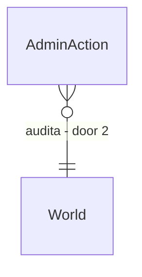

# God console [Estado: Entregue - /admin/* com pausa de teto e AdminAudit append-only (AD-112, 2026-10-14)]

## Problem

A Fase 26 (console e modo god) é só `spec`: pausa, velocidade, busca, eventos marcantes e reescrita com rebuild não têm rota própria além do que o cliente Godot usa. O ADR-0015 fixa pausa global com auditoria de admin, mas `STATE.md` lista como risco aberto que não há limite de duração e nada impede um admin distraído de congelar o mundo.

Evidência: `docs/roadmap/phase-26-console.md`, `STATE.md` (Riscos ainda sem mecanismo).

Quando isto entrar, o admin pausa, acelera e busca NPC com auditoria e tempo máximo de pausa.

## Flow

Reaproveita o scheduler de tempo (Fase 1) e o princípio de auditoria do ADR-0015.

1. `POST /admin/world/pause` (new, door 1) - pausa com motivo e duração máxima
2. `TickScheduler` (exists) - respeita a pausa e a velocidade
3. `AdminAuditLog` (new, door 2) - grava quem, quando e o quê, append-only
4. `GET /admin/search` (new) - busca NPC por nome, cidade e profissão; `GET /admin/audit` lê a auditoria

## Impact

| Front | What changes |
| --- | --- |
| domain | termos: pausa de admin, evento marcante |
| stored data | tabela de auditoria nova, migração nova; mundos antigos começam sem linhas; hash do mundo não muda |

## Relations

One-way constraints: linha de auditoria nunca é editada ou apagada (door 2).

## Surface

| Route | In | Out | Status |
| --- | --- | --- | --- |
| `POST /admin/world/pause` | `reason`, `maxTicks` | estado de pausa | 200, 400, 403 |
| `GET /admin/search` | `q`, `kind` | lista de NPCs | 200, 400 |
| `GET /admin/audit` | `fromTick` | linhas de auditoria | 200, 403 |

## Landing

| One-way door | Literal shape | Alternative rejected |
| --- | --- | --- |
| 1. pausa com teto | pausa grava `maxTicks` e retoma sozinha ao vencer | pausa sem teto: o risco do ADR-0015 continua aberto |
| 2. forma da auditoria | tabela append-only (quem, quando, ação, alvo) sem UPDATE e DELETE | log em arquivo solto: não é consultável e se perde na reconstrução |

- Nada mais aqui é difícil de reverter

## Criteria

### S1: Pausa segura (P1)

**Acceptance Criteria**

1. WHEN o admin pausa THEN the system SHALL parar o relógio e gravar a ação na auditoria
2. WHEN `maxTicks` vence THEN the system SHALL retomar sem intervenção
3. IF o chamador não é admin THEN the system SHALL responder 403 sem alterar o estado

**Independent test:** pausar com teto 100 e avançar o relógio de teste.

### S2: Busca e velocidade (P2)

**Acceptance Criteria**

4. WHEN `GET /admin/search` recebe `q` válido THEN the system SHALL responder 200 ordenado por id
5. IF `kind` é desconhecido THEN the system SHALL responder 400
6. WHEN a velocidade muda THEN the system SHALL manter o hash igual para o mesmo número de ticks
7. The system SHALL manter µs por NPC-tick em no máximo 103% e alocação por tick em no máximo 102% do medido, com hash idêntico em dois processos

**Independent test:** mundo de teste com 40 NPCs. Mais o sensor de escala.

## Out of scope

| Excluded | Why |
| --- | --- |
| reescrita do passado | precisa de ramificação (Fase 18) |
| tela do console no Godot | depende destas rotas |

## Assumptions

| Assumption | Chosen default | Rationale | Confirmed? |
| --- | --- | --- | --- |
| teto padrão de pausa | 7 dias simulados | evita congelar o mundo | n |

**Open questions:** none - all resolved or logged above.

## Observable

| Surface | Decision | Landing |
| --- | --- | --- |
| API `/admin/*` | error shape and codes | AC 3 |

## Sources

- `docs/roadmap/phase-26-console.md`
- ADR-0015 - pausa global e auditoria
