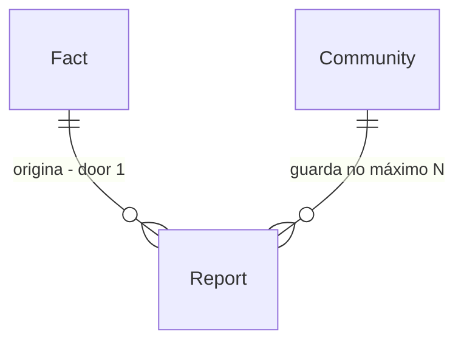

# History narrative close [Estado: Entregue - endpoints /history/*, descarte logado de claim órfão e provas S1/S2 (2026-10-14)]

## Problem

As Fases 10 (história degradável) e 12 (narrativa) estão `pendente` em `ROADMAP.md`, e todas as linhas HIST-01..08 de `.specs/features/phase-10-history/spec.md` seguem `Pending`, embora existam `HistoryIndex`, `DistortionEngine`, `LivingMemoryWindow`, `Books`, `ChronicleGenerationSystem` e `ClaimAnchorValidator` em `src/`. Falta provar, contra os critérios das duas fases, o que existe e ligar o que não tem consumidor: o NPC deve agir sobre a crença, não sobre o fato, e a crônica só pode citar claims ancorados em evento.

Sem isso o roadmap diz que o objetivo "história degradável" não existe e o cliente não tem crônica para mostrar. Evidência: `docs/roadmap/phase-10-history.md`, `docs/roadmap/phase-12-narrative.md`, `docs/audits/phase-gap-review.md`.

Quando isto entrar, a morte da última testemunha vira relato distorcido de forma determinística e a crônica de um período sai ancorada em eventos reais.

## Flow

Reaproveita o que já existe em `History/` e `Narrative/`; o trabalho é medir contra os critérios e ligar consumidores.

1. `HistoryIndex` (exists) - fato imutável com significância na escrita
2. `LivingMemoryWindow` (exists) - testemunha viva; a morte da última agenda a conversão
3. `DistortionEngine` (exists, extended - door 1) - um operador por salto, RNG semeado por (relatoId, salto)
4. `BeliefAssimilationService` (exists, extended) - NPC decide pela crença; `ChronicleGenerationSystem` (exists) só publica claim com `eventIds`

## Impact

| Front | What changes |
| --- | --- |
| domain | termos: relato, salto de transmissão, cânone por comunidade; quem lê hoje: consultas de verdade e de crença |
| stored data | relatos entram com teto `N` por comunidade, custo independente de anos; mundos antigos começam sem relatos |

## Relations

One-way constraints: fato nunca é alterado depois de escrito; relato guarda proveniência e fidelidade (door 1).

## Surface

| Route | In | Out | Status |
| --- | --- | --- | --- |
| `GET /history/truth` | `scope`, `fromTick` | fatos do esqueleto | 200, 403 |
| `GET /history/beliefs` | `communityId` | relatos vivos | 200, 404 |

## Landing

| One-way door | Literal shape | Alternative rejected |
| --- | --- | --- |
| 1. forma do relato | relato com `(factId, meio, salto, fidelidade, distorções[])`, distorção só por operador declarado | reescrever o texto do fato: perde proveniência e não é determinístico |

- Nada mais aqui é difícil de reverter

## Criteria

### S1: Fato vira relato (P1)

**Acceptance Criteria**

1. WHEN a última testemunha morre THEN the system SHALL converter o fato em relato num evento agendado, sem varredura por tick
2. The system SHALL aplicar a mesma distorção para o mesmo (relatoId, salto) em dois processos
3. IF o cânone da comunidade excede `N` THEN the system SHALL despejar o relato de menor peso

**Independent test:** cenário com 3 testemunhas e 200 anos simulados em saltos.

### S2: Verdade não vaza (P1)

**Acceptance Criteria**

4. WHEN o NPC decide THEN the system SHALL ler só crença; desligar a checagem SHALL reprovar o teste de mutação
5. IF a consulta de verdade roda sem escopo de motor THEN the system SHALL responder 403
6. WHEN a crônica é gerada THEN the system SHALL descartar com log todo claim sem `eventIds`
7. The system SHALL gerar a mesma lista de claims para a mesma janela e seed
8. The system SHALL manter µs por NPC-tick em no máximo 103% e alocação por tick em no máximo 102% do medido, com hash idêntico em dois processos

**Independent test:** par mutação on/off de um teste de vazamento de verdade. crônica de 10 anos da vila padrão com claim sintético órfão. Mais o sensor de escala.

## Out of scope

| Excluded | Why |
| --- | --- |
| LLM em prosa final | só põe em texto o que já veio distorcido (Fase 11) |
| livros copiados e queimados no mundo | parte da T8; entrega própria se o gate pedir |

## Assumptions

| Assumption | Chosen default | Rationale | Confirmed? |
| --- | --- | --- | --- |
| definição de pronto | critérios das fases 10 e 12, sem reescrevê-los | o gate decide, não a inspeção | n |

**Open questions:** none - all resolved or logged above.

## Observable

| Surface | Decision | Landing |
| --- | --- | --- |
| API `/history/*` | error shape and codes | AC 5 |

## Sources

- `docs/roadmap/phase-10-history.md`, `docs/roadmap/phase-12-narrative.md`
- `.specs/features/phase-10-history/spec.md` - tabela Pending
