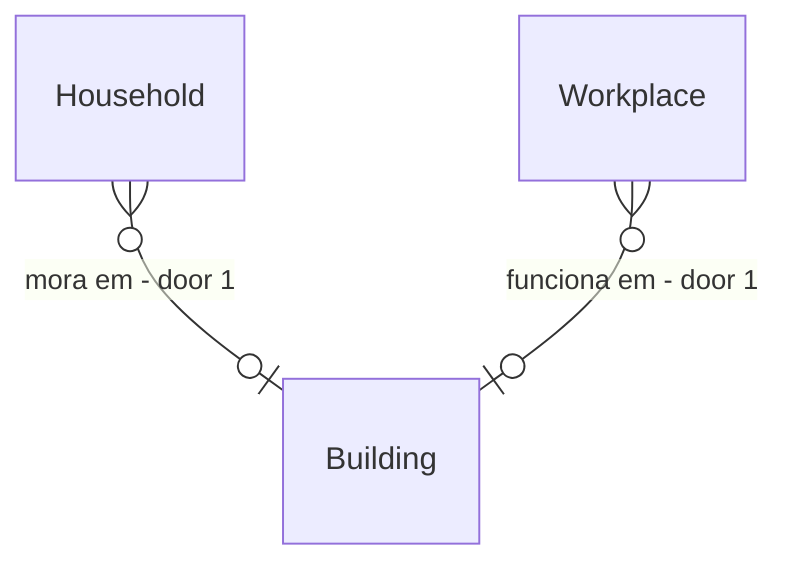

# NPC ocupa o prédio

## Problem
O cliente Godot quer ver NPCs dormindo e trabalhando dentro de casas e oficinas, em andares diferentes. Hoje:
- `Household.Location` e `Workplace.Location` são células de economia; nenhuma das duas entidades aponta para um `Building`.
  O prédio existe (a semeadura cria uma casa por household, a construção cria o prédio do `Workplace`), mas o elo se perde.
- Nenhum sistema de `Simulation` chama `Npc.EnterBuilding`, então `Npc.Interior` só muda em teste.
Quem paga: o interior projetado fica sempre vazio e o cliente teria de adivinhar quem está onde (ADR-0005/0014).
Sem evidência numérica. Ao entregar, quem dorme em casa ou trabalha no emprego aparece dentro do prédio certo, num andar determinístico.

## Flow
Reusa `InteriorEntry` (valida andar e célula) e `BuildingLayoutGenerator` (planta); nada de regra nova de movimento.
1. `PopulationSeeder.PlaceHouseholdBuildings` (exists) - ao criar a casa de cada household, grava `Household.Dwelling` (door 1)
2. `ScenarioRunner.Seeding`, `ScenarioLoaderV2`, `ConstructionSystem` (exist) - ao criar `Workplace` junto do prédio, gravam `Workplace.Building` (door 1)
3. `BuildingOccupancySystem` (new, door 2) - a cada hora decide o `Interior` desejado de cada NPC vivo e aplica por `InteriorEntry`/`ExitBuilding`
4. `InteriorProjector` (exists) - já lista os ocupantes por andar

## Impact
| Front | What changes |
| --- | --- |
| domain | new term: `Dwelling` - prédio onde o household mora; `Workplace.Building` - prédio do local de trabalho |
| domain | existing term: `Npc.Interior` - hoje só preenchido em teste, passa a mudar com a simulação; quem lê: `InteriorProjector` |
| stored data | campos novos nulos; snapshot antigo carrega com `null`, sem backfill; hash canônico, baselines e golden hashes são regravados em commit explícito |

## Relations

One-way constraints: ambos opcionais, sem unicidade (door 1). No columns and no types here.

## Surface
`None - nothing consumed outside`

## Landing
| One-way door | Literal shape | Alternative rejected |
| --- | --- | --- |
| 1 Vínculo explícito e persistido | `Household.Dwelling: BuildingId?`, `Workplace.Building: BuildingId?`, nulos por padrão, sem unicidade | achar o prédio pela célula: footprints se tocam e a origem do `Workplace` é parede, então a busca é ambígua e O(prédios) |
| 2 Ocupação escrita por um sistema próprio | `BuildingOccupancySystem`, Hourly, depois de `BehaviorDecisionSystem`; andar/célula = função pura de `(NpcId, BuildingId)` | gravar dentro de `BehaviorDecisionSystem`: sistemas se comunicam por evento e a decisão já tem 8 partes |

- Household sem casa (casamento, redistribuição) fica com `Dwelling` nulo e o NPC continua fora do prédio

## Criteria
### S1: Vínculo no domínio (P1)
Casa e local de trabalho conhecem o seu prédio.
**Acceptance Criteria**
1. WHEN a semeadura cria a casa de um household THEN the system SHALL gravar `Household.Dwelling` com o `BuildingId` dessa casa.
2. WHEN semeadura, cenário ou construção criam um `Workplace` com prédio THEN the system SHALL gravar `Workplace.Building`.
3. IF `Dwelling` ou `Workplace.Building` aponta para um `BuildingId` inexistente THEN the integrity sweep SHALL falhar.
4. The snapshot SHALL preservar `Dwelling` e `Workplace.Building` na ida e volta, e SHALL carregar `null` quando o campo falta.
### S2: Ocupação (P1)
1. WHILE a ação é `Sleep`, o household tem `Dwelling` e `CurrentLocation == Household.Location` the system SHALL manter `Interior.Building == Dwelling`.
2. WHILE a ação é `Work`, o `Employer` tem `Building` e `CurrentLocation == Workplace.Location` the system SHALL manter `Interior.Building == Workplace.Building`.
3. WHEN nenhuma das duas condições vale THEN the system SHALL deixar `Interior` nulo.
4. The system SHALL escolher andar em `[0, Floors-1]` e uma célula caminhável por função pura de `(NpcId, BuildingId)`, sem `Random`.
5. The system SHALL produzir o mesmo `Interior` de cada NPC em duas execuções da mesma seed.

## Out of scope
| Excluded | Why |
| --- | --- |
| NPC andando dentro do prédio, subindo escada, cômodos | Movimento interno é fase própria; aqui só entrar e sair |
| Dar casa a household nascido de casamento | Decisão de moradia é sistema futuro |

## Assumptions
| Assumption | Chosen default | Rationale | Confirmed? |
| --- | --- | --- | --- |
| Andar de quem dorme | `hash(NpcId) % Floors`, célula caminhável do andar | Distribui moradores pelos andares sem `Random` | n |
| Quem trabalha | Sempre térreo, célula caminhável por hash | Oficina é térrea no primeiro cliente | n |
| Frequência | Hourly, depois de `BehaviorDecisionSystem` | Entrada e saída acompanham a ação na mesma hora | n |

**Open questions:** none - all resolved or logged above.

## Observable
`None - no user-facing surface`

## Sources
- `.specs/features/godot-api-readiness/plan.md` - consome o interior; ADR-0018 - endereço espacial com andar
