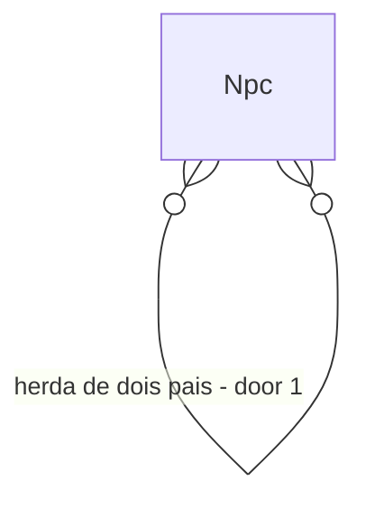

# Personality heredity

## Problem

AD-034 deixou a personalidade sorteada por `WorldRng` sem herança genética, dizendo que a Fase 7 faria a hereditariedade; `docs/audits/phase-gap-review.md` (F7) registra que a hereditariedade de personalidade nunca foi feita e que `OverlapCoefficient` segue sem chamador. Hoje o filho de dois pais corajosos tem personalidade independente deles, então famílias não têm "jeito", e FAM-32 (efeito de seleção) mede um sinal contrário ao exigido (AD-088).

É lacuna de realismo e de critério: sem herança a seleção natural da Fase 7 não tem de onde agir. Evidência: AD-034, AD-088.

Quando isto entrar, a personalidade de um recém-nascido é mistura dos pais mais ruído sorteado, e irmãos se parecem mais do que estranhos.

## Flow

Reaproveita a genética de `NatalitySystem` e o RNG por NPC; só muda a origem dos 10 traços.

1. `NatalitySystem` (exists, extended) - ao nascer chama a mistura
2. `PersonalityInheritance` (new, door 1) - média dos pais por traço mais ruído, peso `w_gene` do cenário (Fase 7)
3. `PersonalityWeighting` (exists) - segue lendo os 10 traços, sem mudança
4. `OverlapCoefficient` (exists) - ganha chamador no teste de seleção

## Impact

| Front | What changes |
| --- | --- |
| domain | termo: herdabilidade de traço; quem lê hoje os traços: `PersonalityWeighting` |
| stored data | sem campo novo, só valores diferentes; o hash muda de propósito para nascimentos, golden regravado com AD |

## Relations

One-way constraints: traços ficam em [0,100] e a mistura é calculada uma vez, no nascimento (door 1).

## Surface

None - nothing consumed outside

## Landing

| One-way door | Literal shape | Alternative rejected |
| --- | --- | --- |
| 1. fórmula da mistura | traço do filho = média dos pais + ruído do `WorldRng` do NPC, cortada em [0,100], peso `w_gene` declarado no cenário | copiar um dos pais: elimina variância e a deriva neutra da Fase 7 |

- Nada mais aqui é difícil de reverter

## Criteria

### S1: Herança mensurável (P1)

**Acceptance Criteria**

1. WHEN um NPC nasce com pais vivos ou mortos conhecidos THEN the system SHALL calcular cada traço pela fórmula declarada
2. The system SHALL manter todo traço em [0,100] em 20 seeds
3. The system SHALL produzir a mesma personalidade para o mesmo nascimento em dois processos

**Independent test:** unidade sobre 1.000 nascimentos sintéticos.

### S2: Famílias se parecem (P1)

**Acceptance Criteria**

4. WHEN há 200 pares de irmãos THEN the system SHALL ter distância média de personalidade menor que entre estranhos, com z ≥ 3
5. WHERE `w_gene` é 0 THEN the system SHALL reproduzir o comportamento atual (sorteio independente)
6. The system SHALL manter µs por NPC-tick em no máximo 103% e alocação por tick em no máximo 102% do medido, com hash idêntico em dois processos

**Independent test:** vila de 20 anos, 20 seeds, controle com `w_gene` 0. Mais o sensor de escala.

## Out of scope

| Excluded | Why |
| --- | --- |
| FAM-32 (efeito de seleção) | decisão D do gap review; é AD, não esta feature |
| genética de aparência | Fase 7 posterior |
| ontogenia (criação molda o traço) | Fase 21 |

## Assumptions

| Assumption | Chosen default | Rationale | Confirmed? |
| --- | --- | --- | --- |
| ruído | uniforme de ±10 pontos | mantém variância sem dominar | n |
| padrão do cenário | `w_gene` 0,5 | mistura leve | n |

**Open questions:** none - all resolved or logged above.

## Observable

None - no user-facing surface

## Sources

- AD-034 e AD-088 em `docs/decisions-log.md`
- `docs/domain/genetics-and-family.md`
- `docs/audits/phase-gap-review.md` (F7)
