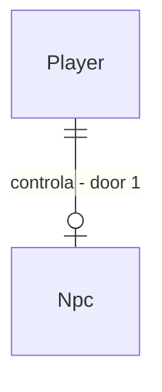

# Player incarnation [Estado: Spec - plano sem checks nem código (specs-closeout 2026-10-12)]

## Problem

A Fase 25 é só `spec` e o cliente Godot deixa o modo jogador fora de escopo (`.specs/features/godot-client/plan.md`: só o `CameraRig` ficou pronto). Não existe rota para assumir um NPC nem evento de desaparecimento ao sair; hoje todo NPC é conduzido pela IA e as ferramentas de autoria só editam o NPC por fora.

Jogador é NPC com controlador externo, sem regra especial. A primeira fatia entrega encarnar um NPC existente e o logout como desaparecimento. Evidência: `docs/roadmap/phase-25-players.md`.

Quando isto entrar, assumir um NPC troca só o controlador, e sair do jogo faz o NPC sumir enquanto o mundo e a família reagem pelas regras de sempre.

## Flow

Reaproveita a decisão por ação do NPC; o controlador externo substitui só a escolha, nunca a resolução.

1. `POST /players/{npcId}/incarnate` (new, door 1) - valida e marca o controlador
2. `BehaviorDecisionSystem` (exists, extended) - pula a escolha autônoma de NPC com controlador
3. `HouseholdRedistribution` (exists) - o desaparecimento reaproveita herança e vaga reaberta
4. `PlayerDisappearanceSystem` (new) - no logout emite o evento e libera o controlador
5. `WorldEventLog` (exists) - grava o desaparecimento

## Impact

| Front | What changes |
| --- | --- |
| domain | termos: controlador, encarnação, desaparecimento |
| stored data | campo `ControllerId` canônico no NPC, nulo na maioria; mundos antigos ficam nulos; hash muda só para NPCs encarnados |

## Relations

One-way constraints: um NPC tem no máximo um controlador e um controlador no máximo um NPC (door 1).

## Surface

| Route | In | Out | Status |
| --- | --- | --- | --- |
| `POST /players/{npcId}/incarnate` | `playerId` | controlador atribuído | 200, 404, 409 |
| `POST /players/{playerId}/logout` | corpo vazio | evento de desaparecimento | 200, 404 |

## Landing

| One-way door | Literal shape | Alternative rejected |
| --- | --- | --- |
| 1. identidade do jogador | `ControllerId` opcional no NPC, nunca um tipo de NPC separado | subclasse `PlayerNpc`: cria caminho de regra paralelo, proibido pela Fase 25 |

- Nada mais aqui é difícil de reverter

## Criteria

### S1: Encarnar (P1)

**Acceptance Criteria**

1. WHEN o jogador assume um NPC vivo livre THEN the system SHALL registrar o controlador sem alterar nenhum outro campo do NPC
2. IF o NPC já tem controlador THEN the system SHALL responder 409 e não alterar o hash
3. The system SHALL manter fome, sono, envelhecimento e morte iguais para NPC controlado

**Independent test:** NPC controlado e outro igual por 1 ano: mesmas necessidades.

### S2: Logout é desaparecimento (P1)

**Acceptance Criteria**

4. WHEN o jogador sai THEN the system SHALL emitir evento de desaparecimento e continuar a simulação sem congelar o NPC
5. WHEN há vínculo próximo THEN the system SHALL ligar procura e herança pelas regras da Fase 7
6. IF o NPC desaparecido morre THEN the system SHALL aplicar as mesmas regras de morte de qualquer NPC
7. The system SHALL manter µs por NPC-tick em no máximo 103% e alocação por tick em no máximo 102% do medido, com hash idêntico em dois processos

**Independent test:** logout em T; 1 ano depois a família reagiu e a vaga reabriu. Mais o sensor de escala.

## Out of scope

| Excluded | Why |
| --- | --- |
| multiplayer e autenticação | Fase 25 posterior; ADR-0015 |
| tela de jogador no Godot | cliente depois do contrato congelado |

## Assumptions

| Assumption | Chosen default | Rationale | Confirmed? |
| --- | --- | --- | --- |
| escolha do jogador | ação do catálogo atual | evita caminho de regra novo | n |

**Open questions:** none - all resolved or logged above.

## Observable

| Surface | Decision | Landing |
| --- | --- | --- |
| API `/players/*` | error shape and codes | AC 2 |

## Sources

- `docs/roadmap/phase-25-players.md`
- `.specs/features/godot-client/plan.md` - modo jogador fora
