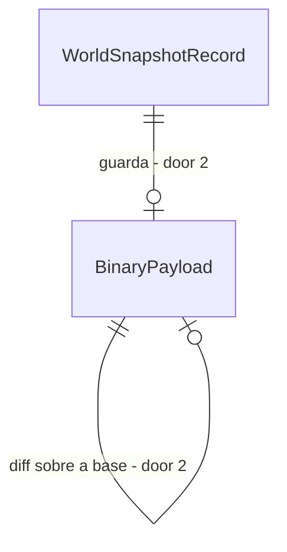

# Snapshot positional binary

## Problem

`BinarySnapshotWriter` é binário só no nome: magic mais JSON UTF-8 com prefixo de tamanho, e `WriteDelta` ainda
serializa o mundo inteiro. A persistência (`PersistentWorldRunner`) grava `WorldSnapshot.Serialize` em JSON na
coluna `Json` de `WorldSnapshotRecord`, e `IncrementalHasher.CombineIncremental` não tem chamador (AD-070 deixou o
hash incremental como stub). Medido em `tests/baselines/scale-sensor.json`: 131.737 B/NPC/ano com 1.000 NPCs,
149.661 com 5.000, cerca de 10.978 B por NPC vivo; a meta da Fase 9 é no máximo 50 B/NPC/ano. Quem paga é o custo de
armazenar anos de mundo vivo.

Quando isto entrar, salvar é gravar só o que mudou, e o carregamento reconstrói o mundo byte a byte.

## Flow

Reaproveita o mecanismo de reflexão sobre `[Canonical]` que já cobre o hash e o `CanonicalMutationNotifier` de `Npc`
para saber o que está sujo, em vez de manter um segundo mapa de campos.

1. `PersistentWorldRunner` (exists) - a cada intervalo pede o snapshot
2. `PositionalSnapshotCodec` (new, door 1) - codifica campos `[Canonical]` na ordem declarada, inteiros varint e strings por tabela
3. `BinarySnapshotWriter` (exists) - passa a gravar base mais diffs dos sujos; `ReadAndApply` reconstrói
4. `IncrementalHasher` (exists) - combina hash por entidade e recalcula só os sujos
5. `SqliteWorldRepository` (exists) - persiste o bloco binário no registro de snapshot (door 2)

## Impact

| Front | What changes |
| --- | --- |
| domain | novo termo: snapshot-base e diff; quem lê hoje o JSON: `PersistentWorldRunner.LoadAt`, `SqliteWorldRepository`, testes de snapshot |
| stored data | snapshots JSON já gravados continuam legíveis; a escrita nova é só binária; o hash canônico do mundo não muda (golden idêntico) |

## Relations

One-way constraints: o formato carrega versão de esquema (door 1) e o bloco antigo em JSON permanece (door 2).

## Surface

None - nothing consumed outside

## Landing

| One-way door | Literal shape | Alternative rejected |
| --- | --- | --- |
| 1. formato do arquivo | cabeçalho com magic e versão de esquema, depois campos na ordem de declaração, inteiros varint, strings por tabela interna | JSON comprimido com gzip: não dá diff por entidade nem hash incremental, e perde o teste de cobertura por reflexão |
| 2. coluna do snapshot | coluna nova de bloco binário nula para linhas antigas, mais migração EF nova (migração aplicada nunca se edita) | trocar o tipo da coluna `Json` existente: quebra a leitura de snapshots já gravados |

- Nada mais aqui é difícil de reverter

## Criteria

### S1: Codec posicional (P1)

**Acceptance Criteria**

1. WHEN um mundo é codificado e decodificado THEN the system SHALL devolver um mundo de hash canônico igual e bytes iguais ao recodificar, em 10 anos e 20 seeds
2. IF um campo `[Canonical]` não tem codificação THEN the system SHALL reprovar o teste de cobertura por reflexão
3. The system SHALL produzir bytes idênticos em dois processos, mesma seed e mesmos ticks

**Independent test:** round-trip em 20 seeds mais o teste de dois processos já existente.

### S2: Redução de bytes (P1)

**Acceptance Criteria**

4. The system SHALL medir no fixture de 1.000 NPCs no máximo 50% dos 131.737 B/NPC/ano do baseline na etapa 1
5. WHEN o diff é gravado THEN the system SHALL conter só NPCs e cidades sujos desde a base

**Independent test:** `ScaleScenarioSensorTests` com o baseline regravado de forma explícita.

### S3: Hash incremental (P1)

**Acceptance Criteria**

6. WHILE o mundo roda 10 anos the system SHALL manter o hash incremental igual ao hash do zero a cada 100 ticks
7. The system SHALL manter o golden `tests/golden/world-hashes.json` inalterado por esta feature

**Independent test:** comparar os dois hashes em amostragem e rodar o golden.

### S4: Persistência ligada (P1)

**Acceptance Criteria**

8. WHEN o runner grava e reabre um mundo THEN the system SHALL restaurar base mais diffs e continuar com hash igual a uma execução contínua
9. WHERE a linha do snapshot é antiga, só com JSON, the system SHALL carregar pelo leitor JSON
10. The system SHALL manter zero idas ao banco durante o tick (`ZeroRoundTripsTests` verde)

**Independent test:** salvar em T, reabrir em outro processo, rodar até T+3650 e comparar com execução contínua.

### S5: Custo (P1)

**Acceptance Criteria**

11. The system SHALL manter µs por NPC-tick do fixture de 1.000 NPCs em no máximo 102% do medido antes e alocação por tick em no máximo 102%, incluindo o custo de `TouchCanonical`
12. The system SHALL carregar um mundo de 10.000 NPCs em no máximo o tempo do carregamento JSON atual

**Independent test:** `MeasureHarness` mais tempo de salvar e carregar antes e depois.

## Out of scope

| Excluded | Why |
| --- | --- |
| Postgres | ADR futuro |
| compressão do log de eventos | Fase 28 T1, spec própria |
| mudar o hash canônico | só o formato de arquivo muda; golden idêntico é critério |

## Assumptions

| Assumption | Chosen default | Rationale | Confirmed? |
| --- | --- | --- | --- |
| etapas | 4 entregas, cada uma mede (codec, diff, hash, persistência) | cada uma é verificável sozinha | n |
| intervalo de base | uma base nova a cada 12 diffs | limita o custo de reconstruir | n |

**Open questions:** none - all resolved or logged above.

## Observable

None - no user-facing surface

## Sources

- `docs/roadmap/phase-09-scale.md` (T6, PERF-12) - binário, delta e hash incremental
- `tests/baselines/scale-sensor.json` - bytes medidos hoje
