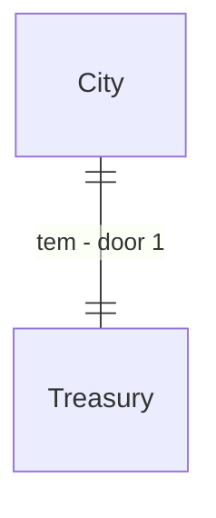

# Taxes treasury

## Problem

`WorldState` tem `Mint`/`Destroy` (matéria-prima de moeda) mas nenhum sistema os usa: não há imposto, tesouro de cidade nem gasto público, e a moeda só circula entre carteiras e oficinas. O roadmap da Fase 5 e o `trade-ledger` deixam isso explicitamente fora ("spec própria; ainda sem fonte de produção"). Sem imposto não há como financiar muralha, estrada ou obras, e a cidade cresce sem receita.

Evidência: `docs/audits/phase-gap-review.md` (F5: `Mint/Destroy` sem sistema), `.specs/features/trade-ledger/plan.md` (Out of scope).

Quando isto entrar, a cidade cobra uma taxa sobre salário e compra, guarda no tesouro e gasta em obra, mantendo a moeda total conservada.

## Flow

Reaproveita `MarketTransaction`, `WagePaymentSystem` e o livro de trocas para saber o valor cobrado.

1. `WagePaymentSystem` (exists, extended) - retém a alíquota da cidade no pagamento
2. `TreasurySystem` (new, door 1) - acumula por cidade e fecha a conta mensal
3. `CityGrowthSystem` (exists, extended) - gasta tesouro em obra (muralha, poço)
4. `TradeLedgerSystem` (exists) - fonte do valor tributável de compras

## Impact

| Front | What changes |
| --- | --- |
| domain | novo termo: tesouro da cidade e alíquota; quem lê hoje o salário líquido: `WagePaymentSystem` |
| stored data | saldo por cidade no estado canônico; mundos antigos começam com 0; o hash muda de propósito, golden regravado com AD |

## Relations

One-way constraints: o tesouro nunca fica negativo e só recebe por retenção ou espólio (door 1).

## Surface

| Route | In | Out | Status |
| --- | --- | --- | --- |
| `GET /cities/{id}/treasury` | `fromDay`, `toDay` | receita e gasto por mês | 200, 404 |

## Landing

| One-way door | Literal shape | Alternative rejected |
| --- | --- | --- |
| 1. forma do tesouro | saldo inteiro por cidade mais agregado mensal de receita e gasto, sem evento por cobrança | evento por imposto pago: estoura o orçamento de bytes (131.737 B/NPC/ano medido) |

- Nada mais aqui é difícil de reverter

## Criteria

### S1: Receita conservada (P1)

**Acceptance Criteria**

1. WHEN um salário é pago THEN the system SHALL reter a alíquota e creditar o tesouro da cidade do empregador
2. IF o tesouro é insuficiente para uma obra THEN the system SHALL adiar a obra sem alterar saldos
3. The system SHALL manter moeda total do mundo constante em 30 dias

**Independent test:** vila padrão por 30 dias com auditoria de conservação.

### S2: Gasto vira cidade (P1)

**Acceptance Criteria**

4. WHEN o tesouro atinge o custo de uma obra THEN the system SHALL gastar e iniciar a obra
5. The system SHALL registrar um agregado mensal por cidade
6. WHEN `GET /cities/{id}/treasury` recebe intervalo válido THEN the system SHALL responder 200
7. IF a cidade não existe THEN the system SHALL responder 404
8. The system SHALL manter µs por NPC-tick em no máximo 103% e alocação por tick em no máximo 102% do medido, com hash idêntico em dois processos

**Independent test:** cidade com receita em 1 ano constrói ao menos uma obra. chamada HTTP contra mundo de teste. Mais o sensor de escala.

## Out of scope

| Excluded | Why |
| --- | --- |
| imposto sobre herança | depende de `estate-inheritance` |
| corrupção e desvio | Fase 23 (intriga) |

## Assumptions

| Assumption | Chosen default | Rationale | Confirmed? |
| --- | --- | --- | --- |
| alíquota | cenário, padrão 5% do salário | calibrar no AD-046 | n |

**Open questions:** none - all resolved or logged above.

## Observable

| Surface | Decision | Landing |
| --- | --- | --- |
| API `/cities/{id}/treasury` | error shape and codes | AC 7 |

## Sources

- `docs/roadmap/phase-05-economy.md`
- `.specs/features/trade-ledger/plan.md`
