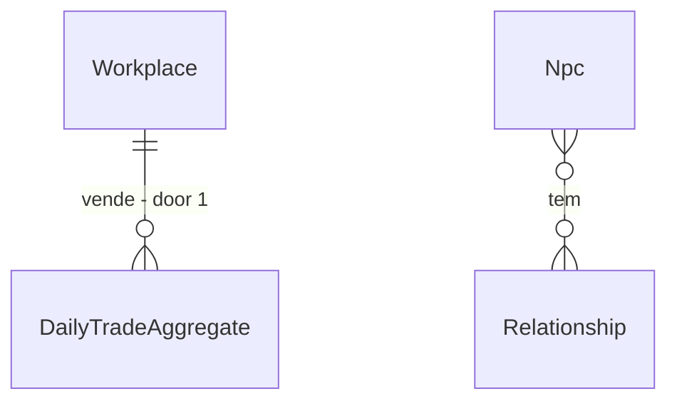

# Trade ledger

## Problem

`TryApplyBuy` (`BehaviorDecisionSystem.Effects.cs`) executa `MarketTransaction` e muda carteira, tesouro e estoque
sem gravar nada: a história não sabe quem comprou o quê, o roadmap da Fase 5 (T8) pede "toda transação vai para o
event log", e o evento de relação `Trade` nunca é disparado. O vendedor hoje é `Workplace.Treasury` (AD-044, sem
dono NPC), então não há contraparte pessoa. Evidência: `docs/audits/phase-gap-review.md` (F5, F7).

Gravar um evento por compra pode estourar o orçamento de armazenamento (131.737 B/NPC/ano medido em
`tests/baselines/scale-sensor.json`), por isso a forma do registro é decisão a medir.

Quando isto entrar, dá para consultar "quanto custou o trigo no ano X" e quem atende uma oficina ganha relação com quem compra.

## Flow

Reaproveita `MarketTransaction` (já atômica) e o `ctx.LogEvent` existente; nenhum mecanismo de log novo.

1. `BehaviorDecisionSystem.TryApplyBuy` (exists) - decide a compra e chama `MarketTransaction.Execute`
2. `MarketTransaction` (exists) - muda os 4 saldos de forma atômica
3. `TradeLedger` (new, door 1) - acumula por dia e por (oficina, recurso) quantidade, valor e compradores; emite `Trade` só para compra relevante
4. `TradeLedgerSystem` (new, no door - placement per conventions) - Daily, fecha o dia e grava o agregado no cânone
5. `RelationshipSystem` (exists) - `ApplyEvent(Trade)` entre comprador e o empregado que atende

## Impact

| Front | What changes |
| --- | --- |
| domain | novo termo: livro de trocas, agregado diário por oficina e recurso |
| domain | `RelationshipEventType.Trade` existia sem fonte; passa a ter, quem lê hoje: `Relationship.ApplyEvent` (deltas 0 no padrão) |
| stored data | mundos salvos antes não têm livro: começa vazio, nada a migrar; bytes por NPC por ano sobem (limite no critério 7) |

## Relations

One-way constraints: um agregado por (oficina, recurso, dia) (door 1).

## Surface

| Route | In | Out | Status |
| --- | --- | --- | --- |
| `GET /workplaces/{id}/trades` | `fromDay`, `toDay` | agregados por dia e recurso | 200, 404 |

## Landing

| One-way door | Literal shape | Alternative rejected |
| --- | --- | --- |
| 1. forma do registro | agregado diário por (oficina, recurso) no estado canônico, mais evento `Trade` só para compra acima do p90 do dia da oficina ou primeiro contato comprador-atendente | um evento por compra: cerca de 1 evento por NPC por dia estoura o teto de bytes por NPC por ano |

- Nada mais aqui é difícil de reverter

## Criteria

### S1: Toda compra deixa registro (P1)

**Acceptance Criteria**

1. WHEN uma compra é concluída THEN the system SHALL somar no agregado do dia exatamente a quantidade e o valor pagos
2. IF a `MarketTransaction` falha em qualquer passo THEN the system SHALL não alterar o agregado e deixar o hash idêntico
3. The system SHALL fechar cada dia com a soma dos valores do agregado igual à soma da moeda que saiu das carteiras compradoras

**Independent test:** 30 dias de vila padrão, somar o livro e comparar com a variação das carteiras.

### S2: Compra relevante vira evento e relação (P1)

**Acceptance Criteria**

4. WHEN a compra passa do p90 do dia da oficina ou é o primeiro contato comprador-atendente THEN the system SHALL emitir `Trade` com `compradorId|atendenteId|recurso|valor`
5. WHEN há `Trade` com atendente NPC THEN the system SHALL aplicar `ApplyEvent(Trade)` ao comprador sobre o atendente, com deltas declarados no cenário
6. WHERE a oficina não tem empregado THEN the system SHALL registrar só o agregado, sem evento de relação

**Independent test:** vila padrão por 1 ano: existem `Trade` e relações comprador-atendente.

### S3: Orçamento de armazenamento (P1)

**Acceptance Criteria**

7. The system SHALL manter bytes por NPC por ano do fixture de 1.000 NPCs em no máximo 110% do baseline `scale-sensor.json`
8. The system SHALL manter µs por NPC-tick em no máximo 103% e alocação por tick em no máximo 102% do medido antes
9. The system SHALL produzir livro idêntico em dois processos, mesma seed e mesmos ticks

**Independent test:** sensor de escala e teste de dois processos.

### S4: Consulta (P2)

**Acceptance Criteria**

10. WHEN `GET /workplaces/{id}/trades` recebe um intervalo de dias válido THEN the system SHALL responder 200 com os agregados do intervalo em ordem de dia
11. IF o id da oficina não existe THEN the system SHALL responder 404

**Independent test:** chamada HTTP contra mundo de teste.

## Out of scope

| Excluded | Why |
| --- | --- |
| comércio entre cidades | depende de rotas e preço regional (Fase 10+) |
| imposto e tesouro (`Mint`/`Destroy`) | spec própria; ainda sem fonte de produção |
| crédito e dívida em dinheiro | fora do mercado atual |

## Assumptions

| Assumption | Chosen default | Rationale | Confirmed? |
| --- | --- | --- | --- |
| contraparte da compra | empregado de menor id presente na oficina na hora | determinístico, sem dono NPC (AD-044) | n |
| limiar de relevância | p90 do valor das compras do dia na oficina | evita escolher número mágico | n |

**Open questions:** none - all resolved or logged above.

## Observable

| Surface | Decision | Landing |
| --- | --- | --- |
| API `GET /workplaces/{id}/trades` | error shape and codes | AC 11 |
| API `GET /workplaces/{id}/trades` | intervalo inválido | existing - rotas de consulta já devolvem 400 para intervalo invertido |
| API `GET /workplaces/{id}/trades` | versioning, rate limits | n/a - API local sem versionamento nem limite hoje |

## Sources

- `docs/roadmap/phase-05-economy.md` (T8) - toda transação vai para o log
- AD-044 - vendedor é oficina, sem dono
