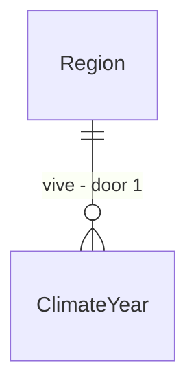

# Weather drought

## Problem

Só existe delta sazonal de temperatura (`TemperatureSeasonSystem`); não há clima variável nem seca, chuva ou geada de ano ruim (`grep Weather|Drought` em `src/` volta vazio). `CropSystem` lê temperatura, mas a colheita não tem ano bom ou ruim, então a fome nunca vem de uma safra perdida e o estoque de grão não tem razão para existir além do consumo diário.

Sem variância de safra a economia é estável demais para ser realista e o preço de comida nunca sobe por causa natural. Evidência: `src/LivingWorld.Simulation/Geography/TemperatureSeasonSystem.cs`, `Economy/Production/CropSystem.cs`.

Quando isto entrar, cada região tem anos de safra boa e ruim determinísticos por seed, e o preço, o estoque e a migração reagem a uma seca.

## Flow

Reaproveita o ciclo sazonal e o `CropSystem`; clima é só mais um modificador de rendimento.

1. `TemperatureSeasonSystem` (exists) - estação atual por região
2. `ClimateYearSystem` (new, door 1) - no início do ano sorteia um fator de chuva por região com RNG semeado
3. `CropSystem` (exists, extended) - rendimento multiplicado pelo fator do ano
4. `MarketPricingSystem` (exists) - preço reage à escassez já existente
5. `CityGrowthSystem` (exists) - migração por fome já existente

## Impact

| Front | What changes |
| --- | --- |
| domain | novo termo: ano de safra; quem lê hoje o rendimento: `CropSystem` |
| stored data | fator do ano por região no estado canônico; mundos antigos assumem fator 1,0; o hash muda de propósito, golden regravado com AD |

## Relations

One-way constraints: um fator por (região, ano), nunca editado depois de sorteado (door 1).

## Surface

None - nothing consumed outside

## Landing

| One-way door | Literal shape | Alternative rejected |
| --- | --- | --- |
| 1. forma do clima | fator inteiro em milésimos por (região, ano), sorteado do RNG do mundo, mínimo 300 e máximo 1500 | simulação de meteorologia diária: custo por tick sem ganho para a decisão |

- Nada mais aqui é difícil de reverter

## Criteria

### S1: Safra varia (P1)

**Acceptance Criteria**

1. WHEN o ano começa THEN the system SHALL sortear o fator por região com RNG semeado do mundo
2. The system SHALL produzir o mesmo fator em dois processos, mesma seed e mesmo ano
3. WHERE o cenário não declara clima THEN the system SHALL usar fator 1,0 e manter o golden do `test-scifi`

**Independent test:** 20 anos, 10 seeds.

### S2: Seca tem consequência (P1)

**Acceptance Criteria**

4. WHEN o fator do ano fica abaixo de 600 THEN the system SHALL reduzir a colheita da região em proporção igual
5. WHEN o estoque de grão cai THEN the system SHALL subir o preço pelo mecanismo de escassez existente
6. The system SHALL manter a vila padrão sem extinção em 20 anos, com seca no ano 5
7. The system SHALL manter µs por NPC-tick em no máximo 103% e alocação por tick em no máximo 102% do medido, com hash idêntico em dois processos

**Independent test:** vila com seca forçada no ano 5. Mais o sensor de escala.

## Out of scope

| Excluded | Why |
| --- | --- |
| clima diário e eventos meteorológicos | custo por tick; ano de safra basta |
| armazenamento e silo | estoque já existe; política é outra feature |
| ajuda entre cidades | depende de rotas de comércio |

## Assumptions

| Assumption | Chosen default | Rationale | Confirmed? |
| --- | --- | --- | --- |
| distribuição | uniforme entre mínimo e máximo, cenário pode trocar | simples e determinística | n |
| escopo | só culturas que o `CropSystem` já cobre | evita recurso novo | n |

**Open questions:** none - all resolved or logged above.

## Observable

None - no user-facing surface

## Sources

- `src/LivingWorld.Simulation/Geography/TemperatureSeasonSystem.cs`
- `docs/roadmap/phase-05-economy.md`
- AD-046 - calibração econômica
