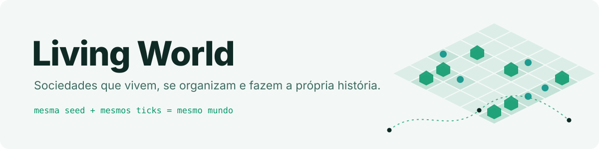
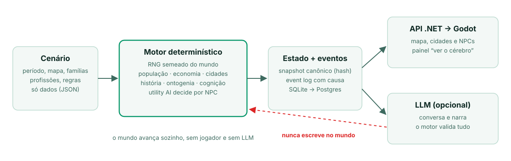

<p align="center">
  <picture>
    <source media="(prefers-color-scheme: dark)" srcset="docs/media/banner-dark.svg">
    
  </picture>
</p>

<h3 align="center">Um mundo que continua vivendo quando ninguém está olhando.</h3>

<p align="center">
  Simulador persistente de sociedades, populações e indivíduos: famílias, economia, cidades, nascimentos,<br>
  mortes e memória histórica resolvidos por um motor determinístico. A LLM conversa e narra, mas nunca decide o mundo.
</p>

<p align="center">
  <a href="#começando"><b>Começando</b></a> · <a href="ROADMAP.md">Roadmap</a> · <a href="docs/README.md">Domínio</a> · <a href="docs/adr/">ADRs</a> · <a href="client/godot/README.md">Cliente Godot</a> · <a href="CONTRIBUTING.md">Contribuir</a>
</p>

<p align="center">
  <a href="https://github.com/AlanEdward19/LivingWorld/actions/workflows/ci.yml"></a>
  
  
  
  
</p>

## Por quê

Mundos de jogo costumam parar quando o jogador sai da sala, e a história deles é um roteiro. No Living World o mundo
**avança sozinho**: cada NPC tem corpo, necessidades, personalidade, família, profissão e memória; cidades crescem,
encolhem e fundam outras; o passado se distorce ao ser recontado. Tudo sai de um motor **determinístico** — mesma
seed + mesmos ticks = mesmo mundo, provado por hash — e cada transformação relevante tem causa rastreável.

<p align="center">
  <picture>
    <source media="(prefers-color-scheme: dark)" srcset="docs/media/how-it-works-dark.svg">
    
  </picture>
</p>

## O que já existe

- **Vida inteira por NPC.** Nascimento sem saber nada (ontogenia), necessidades e rotina por utility AI, habilidades, casamento, genética e herança, morte — 100 NPCs por 100 anos sem LLM.
- **Economia e cidades.** Produção, preço por oferta e demanda, emprego, salário, aluguel, imposto e tesouro; cidades que constroem, migram, fundam filhas e se fundem.
- **História degradável.** Fato, relato e distorção por transmissão; cada comunidade acredita na sua versão. Crônicas e biografias ancoradas em eventos reais.
- **Ver o cérebro.** Painel que mostra estímulo → ponderação → decisão de um NPC, com sandbox "E se…?".
- **Conversa com LLM sem quebrar o mundo.** O NPC fala via LLM; o motor valida e a LLM nunca escreve no estado ([rules/llm-boundary.md](rules/llm-boundary.md)).
- **Períodos como dados.** Pré-histórico, medieval, moderno, futurista e criaturas sobre o mesmo motor.
- **Cliente Godot 3D.** Mapa, cidades, interiores, fichas, economia, crônicas, encarnar um NPC e console de admin.

## Começando

Pré-requisitos: [.NET SDK 10](https://dotnet.microsoft.com/download), `bash` (Git Bash no Windows) e, para o cliente, [Godot 4.7](https://godotengine.org/).

```bash
git clone https://github.com/AlanEdward19/LivingWorld && cd LivingWorld
bash scripts/verify.sh            # gate: docs + build + lint + testes rápidos (sai 0 = tudo ok)
GODOT_BIN=/caminho/do/godot bash scripts/play.sh   # sobe a API com o mundo vivo e abre o cliente
```

Só a API: `bash scripts/play.sh --api-only` (porta 5214) ou `run.cmd` no Windows. Controles e telas do cliente:
[client/godot/README.md](client/godot/README.md). Cenários e períodos ficam em [`scenarios/`](scenarios/).

<details>
<summary>Todos os comandos</summary>

| Comando | O que faz |
|---|---|
| `bash scripts/verify.sh [--full\|--nightly]` | Gate: docs, build, lint e testes (`--full` soma cenários, integração e 100 anos) |
| `bash scripts/test.sh [--filter <p>] [--scenarios] [--project integration\|longrunning]` | Testes por camada |
| `bash scripts/build.sh` · `bash scripts/lint.sh [--fix]` | Build Release com warnings como erro · formatação |
| `bash scripts/client-test.sh` · `bash scripts/client-stress.sh` | Testes headless do cliente · FPS com 500 NPCs |
| `bash scripts/compare-simulation-cost.sh <base>` | Custo por NPC-tick antes/depois (teto +3% CPU, +2% alocação) |
| `bash scripts/refresh-world-hashes.sh` | Regrava goldens após mudança de comportamento registrada |

</details>

## Roadmap

- ✅ Núcleo (fases 0–9): tempo, geografia, população, necessidades, economia, habilidades, família, cidades, escala
- ✅ Mundo vivo (10–13, 21, 28): história, LLM, narrativa, períodos, ontogenia, cognição
- 🚧 Emergência, jogadores e console (24–26): [#61](https://github.com/AlanEdward19/LivingWorld/issues/61), [#63](https://github.com/AlanEdward19/LivingWorld/issues/63), [#62](https://github.com/AlanEdward19/LivingWorld/issues/62)
- 🚧 Interações presenciais: salário, aluguel, namoro e furto só com encontro ([#68](https://github.com/AlanEdward19/LivingWorld/issues/68))
- 🔜 Sociedades e civilizações: cultura, organizações, governo, lei, diplomacia ([#111](https://github.com/AlanEdward19/LivingWorld/issues/111))
- 🔜 Imperfeição e intriga (22–23), depois linhas temporais, cinemática e o extraordinário (17–20, 27)

Fases, critérios e ordem: [ROADMAP.md](ROADMAP.md). Não é um roteirista nem um chatbot com cenário: o mundo é a fonte da verdade.

## Documentação

[Domínio](docs/README.md) · [ADRs](docs/adr/) · [Roadmap por fase](docs/roadmap/) · [Regras do motor](rules/) · [Harness](HARNESS.md) · [Cliente Godot](client/godot/README.md) · [Scripts](scripts/README.md) · [Agentes de IA](AGENTS.md)

## Contribuindo

Issues e PRs são bem-vindos. Leia o [CONTRIBUTING.md](CONTRIBUTING.md), discuta ideias grandes numa issue antes de
codar e reporte vulnerabilidades em privado ([SECURITY.md](SECURITY.md)). `bash scripts/verify.sh` precisa sair 0.

## Licença

Ainda não definida. Até lá, o código está público para leitura e estudo, mas sem licença de reuso.
